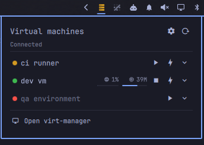

# Omarchy libvirt

A libvirt frontend for the [Omarchy](https://omarchy.org/) bar. The bar item is
a glyph, dimmed when nothing is running; the popup lists every domain on the
connection with a state light, play/stop controls, and a click-to-open console.
Expand a row for pause, reboot, save state and snapshots.

It drives domains and nothing else: it never starts libvirt, never touches
networks, and never opens a connection to a guest. Creating, cloning and
deleting domains stay with virt-manager, which the popup's footer opens.

Claude code was heavily involved in the creation of this widget.



## Using it

Left click the bar item for the popup, right click to open virt-manager, middle
click or scroll to refresh. The glyph turns **amber** while a domain is
suspended and **red** while the connection is down; its tooltip names what is
running.

- **Green** running, **amber** paused, **red** shut off. A row only shows the
  buttons its state allows.
- **The play arrow** starts a shut off domain, or resumes a paused one.
- **The stop square** is `virsh shutdown` — a polite ACPI request the guest can
  ignore.
- **The lightning bolt** is `virsh destroy`. It cuts power and loses unwritten
  guest state, so it takes two clicks: the first arms it, the second does it,
  and it disarms itself after four seconds.
- **Clicking a domain's name** opens its console in `virt-viewer`, only while
  the domain is up.
- **The chevron** expands the row for everything else.
- **A shutdown the guest ignores** turns the lightning bolt red after twenty
  seconds, and its tooltip says how long it has been waiting. `virsh shutdown`
  is only a request, and until now a guest with no ACPI handler looked exactly
  like a button that did nothing.
- **With eight or more domains** a filter field appears above the list.

### Keyboard

The popup takes keyboard focus, so it can be driven without the mouse — bind
`omarchy-shell leyanora.libvirt toggle` and never touch the pointer.

| Key | Does |
|---|---|
| `↑` `↓`, `k` `j` | Move the row cursor |
| `→` `←`, `l` `h` | Expand and collapse the row |
| `Enter`, `Space` | Start, resume or shut down — whichever the row's state means |
| `x` | Force off, or delete a snapshot. Still takes the second press |
| `s` | Snapshots for the row |
| `c` | Console for the row |
| `r` | Refresh |
| `,` | Settings |
| `/` | Jump to the filter field |
| `Tab` | Step through the settings controls |
| `Esc` | Leave the field, then the sub-view, then the popup |

The cursor is shared with the mouse: hovering a row moves it, so there is only
ever one highlight on screen.

### CPU and memory

A running row shows two figures before its buttons, each with a hairline gauge
under it: **CPU** (󰻠) and **memory in use** (󰍛). The CPU figure turns red at
90%. Both come from one `virsh domstats` call that covers every running domain,
every three seconds by default. It runs only while the popup is open or the bar
readout is on, so a closed popup with the bar readout off collects nothing.

- **CPU: 100% means every vCPU assigned to the domain is fully busy.** It is the
  change in libvirt's cumulative `cpu.time` divided by elapsed time × vCPU count,
  the same figure virt-manager shows. It reads `–` until a second sample exists,
  which takes about a second.
- **Memory** prefers guest total minus available memory (`MemTotal - MemAvailable`),
  excluding reclaimable cache. Older guests that only report free memory fall
  back to total minus free, which includes cache. These guest statistics require a
  memory-balloon driver with statistics enabled. Without guest statistics, the
  fallback is host-side QEMU resident memory. Guest figures use the guest total
  as their denominator; host RSS uses the current allocation. The expanded row
  spells out the corresponding used / total values, such as `2.6 / 4 GiB`.

**In the bar**, turning on *Usage in the bar* adds `name 41%` per running
domain next to the glyph. Long names are shortened, and at most three are shown
before a `+N`. The settings view then offers *Domains in the bar* to narrow it
down; choose none to show every running domain. Under **Bar labels**, turn off
*Show domain names* for just the icon and CPU percentages. You can also
turn on *Show memory usage* for `c:2% r:35%`, limit
labels to 1–40 characters or choose a domain and enter a bar alias (Enter or
leaving the field saves it; empty restores the real name). Aliases only change
the bar label, never the tooltip, popup names or libvirt commands. The bar tooltip lists CPU and memory for each running domain while sampling is on.

### In the expanded row

Expanding a row draws a border around it and fills it, so the name and its
buttons read as one object; collapsing it takes both away again. The actions are
a single line of icon pills — hover one to see what it does.

- **Pause** (`virsh suspend`) freezes a running domain; the play arrow resumes
  it.
- **Reboot** (`virsh reboot`) is an ACPI request, the same class as shut down —
  a guest with no handler will ignore it.
- **Save state** (`virsh managedsave`) writes the memory image out and stops
  the domain. Its light goes **hollow** to say it is shut off but not blank,
  and the play arrow becomes a **restore** arrow: starting it puts the guest
  back exactly where it was.
- **Discard saved state** throws that memory image away, so the domain boots
  cold next time. Two clicks, like force off — the armed pill turns red, and its
  hover label says what the second click will do.
- **Snapshots** opens the snapshot list for that domain.

Above the pills, the row reports the domain's **vCPU count and memory**, and for
a domain that is off, **why** — `crashed`, `destroyed` or `shutdown`. Those come
from `virsh dominfo` and `virsh domstate --reason`, asked only when the row is
expanded, never on the poll tick.

### Snapshots

The back arrow returns to the domain list. A check mark against a name is the
**current** snapshot — the one the domain is sitting on. Each snapshot has
**revert** and **delete**; both take two clicks, because reverting throws away
everything the domain has done since the snapshot was taken. The armed button
draws the four-second window down as a bar, so the second click is not on a
hidden timer.

The two fields at the bottom take a snapshot: an optional description, and the
name — leave the name empty and libvirt names it after the epoch second.

Typed names are tidied first: whitespace and `/` collapse to single hyphens and
surrounding whitespace is dropped, so `my snap` is stored as `my-snap`. libvirt
itself only refuses `/` and a leading `.`, but it will happily store
`  my  snap  ` verbatim, and a name you cannot retype is a name you cannot
easily revert to. A name that tidies away to nothing gets libvirt's automatic
one. Existing snapshots are never renamed — only what you type is cleaned.

Internal snapshots need **qcow2** disks. On a raw disk, or a domain with no
disk at all, `virsh` refuses and the popup shows you why.

### The settings view

The cogwheel next to refresh opens a settings view, with the back arrow to
return. It holds the settings worth changing from the bar rather than from a
config file, in three boxes.

**Connection** — the libvirt URI, as a picker between `qemu:///session` and
`qemu:///system` (plus whatever you hand-edited into `shell.json`, if it is
neither), and the poll interval. Switching connection empties the list and
re-polls; the widget still never *starts* libvirt, so a connection that is not
running comes back Disconnected.

**Behaviour** — the running count on the bar glyph, the snapshot button in the
expanded row, CPU and memory in the popup, CPU usage in the bar (with the
domains it covers), and the three confirm switches. The **Connection** box also
holds the usage sampling interval.

**State light colours** — the three lights. Each colour row shows a
swatch, the value in effect, and a palette button that expands the row into a
colour picker: drag in the saturation/value square, pick a hue on the strip
below it, or click one of the preset swatches. The value is shown as hex and as
R/G/B, and both are editable — type a hex value (`#rgb`, `#rrggbb` or
`#aarrggbb`) and press Enter, and anything else is refused with a message rather
than being stored. The circular arrow puts that one colour back to its default.

Only the end of a drag is saved, so the state lights in the list settle when you
let go while the picker itself tracks the pointer.

Whatever you change here is written into the widget's `shell.json` entry, so it
survives a restart; everything else in [Settings](#settings) below stays
hand-edited. The URI is the one value the picker will not let you type: it ends
up in every `virsh` call, so it is chosen from a list rather than entered.

Under the title: **Connected** when libvirt answered the last poll,
**Disconnected** in red when it did not, and **Not installed** when there is no
`virsh` at all. Either way a boxed notice below says what went wrong, and for a
missing `virsh` or `virt-viewer` it also shows the package to install (see
[Prerequisites](#prerequisites)). The URI is on hover. The widget only reads and drives domains — it never starts libvirt, so a
dead connection is yours to bring up from a terminal.

`virsh shutdown` and friends return when the request is queued, not when the
guest acts on it, so expect a row to change state a beat after you click.

## Prerequisites

**This plugin needs manual setup.** `omarchy plugin add` installs the widget,
not libvirt or a console viewer, and without `virsh` the widget can do nothing
but show a **virsh is missing** notice. Install the required set first:

```bash
sudo pacman -S libvirt qemu-full virt-viewer
```

| Package | Why |
|---|---|
| `libvirt` | **Required.** Provides `virsh`, the entire backend |
| `qemu-full` | **Required** (or `qemu-desktop`). The hypervisor, its SPICE modules, every guest architecture and its firmware |
| `virt-viewer` | **Required for consoles.** What clicking a domain name opens; it pulls in `spice-gtk` |
| `virt-manager` | Only the popup's footer button. Set `"manager": ""` to hide that row |
| `edk2-ovmf` | UEFI firmware for guests. Optional, but a modern guest usually wants it |
| `dnsmasq` | Only for `qemu:///system`: the `default` NAT network needs it for DHCP |

**SPICE** is how a console reaches you, and it needs both ends. On the viewer
side, `virt-viewer` brings `spice-gtk`. On the guest side, QEMU loads SPICE as
modules — `qemu-ui-spice-core`, `qemu-chardev-spice`, `qemu-hw-display-qxl` and
`qemu-audio-spice` — which `qemu-full` and `qemu-desktop` include and
`qemu-base` does not. Without them, a domain whose XML has
`<graphics type='spice'>` refuses to start, and the popup shows libvirt's error.
If `virt-viewer` itself is missing, clicking a name shows a notice saying so
instead of launching nothing.

KVM needs no group membership on Arch — `/dev/kvm` is world-writable by udev
rule. Check with `test -w /dev/kvm && echo ok`.

The default connection, `qemu:///session`, needs no further setup: `virsh`
spawns `virtqemud` under your own user on first contact, guests get QEMU
user-mode networking, and definitions live in `~/.config/libvirt/`. The
trade-off is no inbound connections to guests and no networking between them.

Host-wide `qemu:///system` needs more than the packages. Your user has to be
in the `libvirt` group, the libvirt daemon sockets have to be running, and the
`default` network has to be started. `dnsmasq` is only an optional dependency of
`libvirt`, but without it the `default` NAT network cannot hand out DHCP and
refuses to start.

## Install

Install the [prerequisites](#prerequisites) first, then:

```bash
omarchy plugin add https://github.com/Leyanora/omarchy-libvirt.git --enable
```

The widget expects the connection to work without a password prompt. If
`virsh -c <uri> list --all` works in a terminal it works here; if it does not,
the popup shows you the same error.

## Uninstall

```bash
omarchy plugin remove leyanora.libvirt
```

That is the whole thing. It asks once (`--yes` skips), unloads the widget,
deletes `~/.config/omarchy/plugins/leyanora.libvirt`, and drops the widget's
entry — and with it every setting you put there — out of
`~/.config/omarchy/shell.json`.

Nothing of yours is touched: the widget only ever shells out to `virsh`, so
your domains, disks, networks and libvirt config are exactly as you left them.
The packages above stay installed.

## Settings

Every key goes in the widget's entry in `~/.config/omarchy/shell.json`, keyed
by the plugin id — not the display name:

```json
{
  "bar": {
    "layout": {
      "right": [
        { "id": "leyanora.libvirt", "uri": "qemu:///system", "interval": 5 }
      ]
    }
  }
}
```

| Key | Default | What it does |
|---|---|---|
| `uri` | `qemu:///session` | libvirt connection URI. Also selectable from the cogwheel |
| `interval` | `10` | Poll seconds; floored at 2. Also editable from the cogwheel |
| `icon` | `󰒋` | Bar glyph |
| `showCount` | `false` | Show the running count next to the glyph. Also editable from the cogwheel |
| `confirmForceOff` | `true` | Require the second click on force off. Also editable from the cogwheel |
| `confirmDiscardSaved` | `true` | Require the second click on discard saved state. Also editable from the cogwheel |
| `confirmSnapshotRevert` | `true` | Require the second click on snapshot revert and delete. Also editable from the cogwheel |
| `showSnapshots` | `true` | Show the snapshots button in the expanded row. Also editable from the cogwheel |
| `showStats` | `true` | CPU and memory on running rows while the popup is open. Also editable from the cogwheel |
| `barStats` | `false` | CPU usage per running domain in the bar, sampled even while the popup is closed. Also editable from the cogwheel |
| `barMemory` | `false` | Include RAM as a percentage of guest total (allocation when using the host RSS fallback) alongside CPU, e.g. `c:2% r:35%`; reuses the existing samples |
| `barShowNames` | `true` | Show names next to bar CPU percentages. Turn off for a compact readout |
| `barNameLength` | `12` | Maximum bar label length (1–40 Unicode code points, including the ellipsis) |
| `barAliases` | `{}` | Optional labels keyed by `d:` plus the real domain name, e.g. `{"d:example-domain":"vm-a"}` |
| `barDomains` | `[]` | Names of the domains the bar readout covers; empty means every running one. Also editable from the cogwheel |
| `statsInterval` | `3` | Usage sampling seconds, 1–60. Also editable from the cogwheel |
| `console` | `virt-viewer --connect {uri} {name}` | Console command; `{uri}` and `{name}` are substituted shell-quoted |
| `manager` | `virt-manager -c <uri>` | The popup's footer action; `""` hides the row |
| `onRightClick` | same as `manager` | Right click on the bar item |
| `colorRunning` | `#3fb950` | State light, running. Also editable from the cogwheel |
| `colorPaused` | `#d29922` | State light, paused. Also editable from the cogwheel |
| `colorStopped` | `#f85149` | State light, shut off. Also editable from the cogwheel |

## IPC

```bash
omarchy-shell leyanora.libvirt toggle     # also: open, close, show, hide
omarchy-shell leyanora.libvirt refresh    # re-poll on every monitor
```

Bind either in `~/.config/hypr/bindings.lua`.

## Changelog

See [CHANGELOG.md](CHANGELOG.md).

## License

MIT — see [LICENSE](LICENSE).
